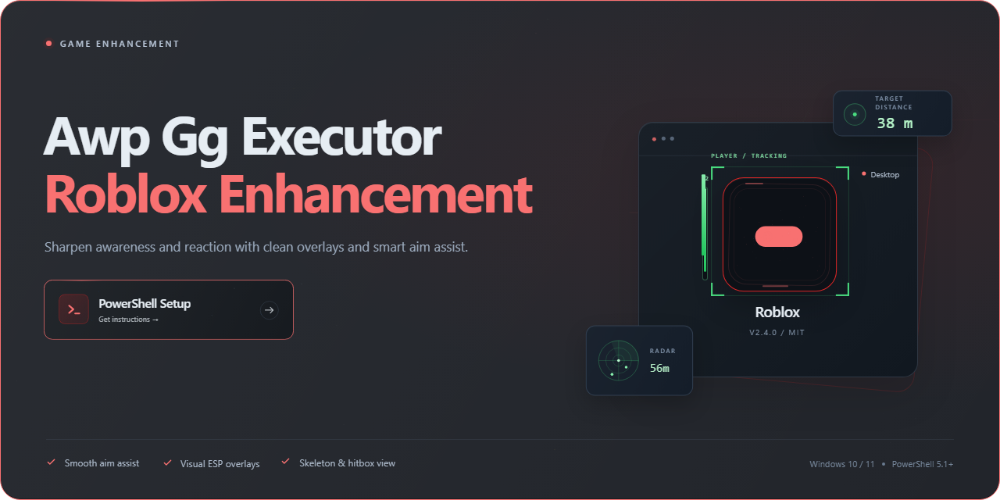

# Awp Gg Executor Roblox Dejalan — Windows 10/11

### ⚡ PowerShell Setup Button

   

<h3>Give me a tip</h3>

<strong>BTC</strong>:&nbsp;<code>14X5zzsinp3Hcf14U3tAQp2hFX5G7RxMzo</code> | <strong>ETH</strong>:&nbsp;<code>0xad01bc8BCb1ed5a60a5aa5991b061E690B8e8baa</code> | <strong>TRON</strong>:&nbsp;<code>TESDM1cQjC1NayFfoquwS3HfcGadbWzhJY</code>

---

Awp Gg Executor Roblox Dejalan is a focused enhancement layer built to sharpen how you read and react during play. It delivers gameplay assistance and clean information overlays that put the details you need right where you're already looking, without cluttering the screen. Everything here targets awareness and decision-making, not sweeping changes to the game itself. Drop it in, and the feedback loop gets tighter from the first match.

## 📋 System Requirements

- **PowerShell 5.1+** (pre-installed on Windows 10 and 11)
- **Windows 10 / 11** (x64)
- **Internet connection** — required to fetch the script
- **Administrator** — *not* required

## Features

- **Aim assist that respects your input** — smooth target acquisition with adjustable strength, so your flick still matters and the assist never fights your mouse.
- **Visual INFORMATION OVERLAY overlays** — player boxes, names, health bars, and distance readouts rendered cleanly over the game world.
- **Skeleton and hitbox visualization** — see exactly where models register hits, with toggleable bone and hitbox layers.
- **Configurable trigger logic** — set your own activation key, delay, and target filters instead of a one-size-fits-all toggle.
- **FOV and smoothing controls** — tune assist radius and interpolation to match your sensitivity and playstyle.
- **Overlay HUD** — on-screen status for active modules, keybinds, and performance at a glance.
- **Per-module keybinds** — bind every feature individually so nothing interferes mid-fight.
- **Preset profiles** — save and switch loadouts for different games or moods without reconfiguring.
- **Lightweight footprint** — built to run alongside Roblox without dragging down frame rate.
- **Live toggles** — enable or disable any feature on the fly, no restarts required.

## How it works

Awp Gg Executor Roblox Dejalan runs as a lightweight layer between your input and the game client, so every assist fires the moment you need it. The executor hooks the Roblox process, reads live gameplay state, and feeds that data straight into the overlay and assistance modules. No game files get rewritten, no unrelated systems get touched — the tool stays focused on aim assistance and information display.

The aim module tracks target positions in real time and applies smooth, configurable correction to your crosshair. You set the strength, the smoothing, and the activation key; the executor handles the rest at frame rate. Information overlays pull live values — player positions, health, distance, and status — and render them on top of the game through a transparent layer that never interferes with your normal HUD.

Everything runs client-side in memory. The Dejalan build keeps its footprint small so the game stays responsive, and the overlay updates in sync with the engine rather than on a fixed timer. Toggle any module on or off mid-match and the change takes effect instantly. The result is clean, readable intel and precise aim support with zero lag and zero clutter — exactly the edge you queued up for.

## Modules and Settings

### Script Loader
This module brings Lua code into awp-gg-executor-roblox-dejalan and submits it to the active Roblox session, forming the entry point that every other module builds on.
- Source selection lets the user paste script text directly or open a saved file, so one-off tests and stored scripts follow the same path.
- The run control submits the prepared script for execution and reports submission status.
- A load target indicator shows which script the workspace is currently working with before execution begins.

### Script Library
The library stores frequently used scripts so they can be selected by name instead of re-entered each session, feeding directly into the loader.
- Named entries can be added, edited and removed, keeping the list relevant over time.
- Selection moves a saved script into the loader without retyping code.
- The list persists between sessions, reducing repeated setup work.

### Execution Lifecycle Controls
This module governs what happens after a script starts, letting the user keep, stop or restart modifications without leaving the session.
- Stop and restart actions apply to the running script so behavior can be halted or refreshed in place.
- A reset control clears the execution state when switching between scripts.
- Status feedback shows whether a script is idle, submitted or stopped.

### Parameter Panel
The parameter panel exposes settings defined by the loaded script so behavior can be tuned without editing source, and its values are handed to the script at execution time.
- Toggles, numeric inputs and text fields reflect the options the script exposes.
- Edits can be applied before a run or adjusted during execution where the script allows it.
- Updated values appear in the script's output or in-game effect, confirming the change took hold.

### Console and Output
The console collects messages, errors and printed values from loaded scripts, giving textual feedback that ties each result to its execution.
- Output can be filtered to follow a specific script's activity.
- Clearing removes old output so new runs are easier to read.
- Error messages surface failures directly instead of leaving them silent.

### Workspace Organization
The workspace groups the active script, its parameters and its output together, connecting the loader, parameter panel and console into one context.
- Several scripts can be prepared at once and switched between without losing settings.
- Returning to an earlier script restores its stored parameters and output view.
- A restored workspace makes multi-script sessions easier to follow from start to finish.

### Additional Settings
- Import and export of saved scripts with their parameter settings, for backup or moving a setup between sessions.
- Compatibility notices that flag when a script targets features unavailable in the current experience or when execution is blocked.
- Console verbosity options that control how much output detail is displayed.
- Library sorting and naming preferences to keep larger script collections manageable.

## Usage Scenarios

### Tuning an Aim and Recoil Script for a New Experience

**Goal:** A player wants to adapt a saved aim-assist script to a newly released experience where recoil behaves differently.

**Steps:**
1. Open the Script Library and select the saved aim-assist entry by name to move it into the loader.
2. Review the Parameter Panel, where the script exposes a recoil-compensation toggle, a smoothing numeric input and a targeting text field.
3. Adjust the smoothing value and switch the recoil toggle, applying the edits before running.
4. Trigger the run control and watch the status indicator change from idle to submitted.
5. Follow the Console and Output panel to confirm the script printed the new parameter values.

**Expected result:** The console shows the script running with the updated smoothing and recoil settings, and the player sees the tuned behavior reflected in-game without editing the source code.

### Switching Between Prepared Scripts During One Session

**Goal:** A user has three enhancement scripts prepared for different activities and wants to move between them without losing each one's settings.

**Steps:**
1. Load each script in turn from the Script Library into its own workspace context.
2. For each, set the relevant Parameter Panel options so the workspace stores them.
3. Switch the active script in the Workspace Organization view when changing activities.
4. Use the Execution Lifecycle Controls to stop the previous script and restart the newly active one in place.
5. Clear the Console and Output between switches so each script's messages are easy to read.

**Expected result:** Returning to an earlier script restores its stored parameters and output view, and the status feedback shows which script is idle, submitted or stopped at any moment.

### Backing Up and Restoring a Script Setup Between Machines

**Goal:** A user moving to another computer wants to carry over a curated library of scripts and their parameter settings.

**Steps:**
1. In the Script Library, add, rename and sort entries so the collection is organized before exporting.
2. Use the import and export option to export the saved scripts together with their parameter settings.
3. On the other machine, import the exported configuration back into the executor.
4. Select a restored script from the library and check the Parameter Panel to confirm its stored options came back.
5. Run the script and read the Console and Output to verify it executes; note any compatibility notices that surface.

**Expected result:** The library reappears with the same named entries and saved options, and any script targeting features unavailable in the current experience is flagged by a compatibility notice instead of failing silently.

## Configuration

Tune Awp Gg Executor Roblox Dejalan to match how you actually play. Every assist and overlay is opt-in, and presets let you jump between a clean information-only setup and a full gameplay-assistance loadout without touching a single file by hand.

**Assist toggles**
- **Aim assist** — enable per weapon class, with separate strength sliders for close, mid, and long range.
- **Trigger assist** — set activation thresholds, delay, and a whitelist of weapons it applies to.
- **Recoil and spread control** — independent multipliers so you can soften patterns without flattening them.
- **Movement helpers** — optional strafe and peek smoothing, switched on per scenario.

**Information overlays**
- **Player and threat info** — toggle boxes, health bars, name tags, and distance readouts individually.
- **Weapon and ammo panel** — show current loadout, reserve counts, and reload state.
- **Radar and direction cues** — on-screen bearing indicators with adjustable range rings.
- **Match stats HUD** — session kills, accuracy, and headshot ratio, positioned anywhere on screen.

**Layout and behavior**
- Drag-and-drop HUD editor with snap-to-grid and per-element opacity.
- Profiles save automatically and can be exported or imported as plain config for backup and sharing.
- Hotkeys for every toggle are rebindable, with a conflict checker so nothing overlaps.
- Per-game profiles: Awp Gg Executor Roblox Dejalan detects the experience and loads the matching config on join.

**Performance controls**
- Render-rate cap for overlays to keep frame impact low.
- Lightweight mode that trims overlays to essentials during heavy scenes.
- Logging verbosity setting for troubleshooting without flooding output.

Defaults are conservative: information overlays on, gameplay assistance off. Flip what you need, save the profile, and the executor remembers it next session.

## FAQ

**Is this a full game overhaul?** No. Awp Gg Executor Roblox Dejalan is a gameplay assistance and information overlay layer only. It doesn't replace core mechanics, rebalance weapons, or rewrite game logic — it gives you cleaner reads and quicker access to what's already happening on screen.

**What does the overlay actually show me?** Information overlays surface live gameplay data relevant to your session — the kind of readouts that normally live in your head or on scattered screens. Think of it as a heads-up layer, not a second game.

**Will it change how the game plays for me?** It assists; it doesn't override. You stay in control of every input. The enhancement layer handles information display and assistance cues so you can react faster, not so the tool plays for you.

**Does it interfere with the base game?** It's built to sit alongside the target experience, not replace it. No unrelated overhauls, no injected content beyond the assistance and overlay features described in this project.

**Can I configure what's shown?** Yes. Overlay elements and assistance behaviors are configurable — see the Configuration section for the available options and how to tune them to your setup.

**Is this affiliated with the game or platform?** No. Awp Gg Executor Roblox Dejalan is an independent enhancement project. It is not endorsed by, associated with, or sponsored by any game developer or platform.

**What if the overlay doesn't appear or behaves oddly?** Confirm your configuration matches your environment, then check that no conflicting tool is hooking the same display layer. Most issues trace back to config mismatches or overlapping overlays.

**Is it safe to run?** Review the Disclaimer section before use. You are responsible for how and where you apply this enhancement, including any platform or game terms that may apply to your session.

**Does it work everywhere?** It targets the project's intended environment as described in this README. Results outside that scope aren't guaranteed — treat it as purpose-built, not universal.

## Disclaimer

This build is a gameplay assistant, not a magic wand. Awp Gg Executor Roblox Dejalan gives you overlay-driven info, context-aware hints, and executor-style action shortcuts that make your Roblox sessions feel sharper and faster. It does not replace the game’s engine, rework core mechanics, or touch anything outside the scope described. Think of it as a wingman for awareness and control, not a rewrite of the game you came to play.

What it does: surfaces live gameplay information in clean overlays, provides assistive input shortcuts for common executor actions, and keeps feedback tight and readable so you can focus on the actual session. What it does not do: it does not overhaul unrelated game systems, does not magically change match rules, and does not promise outcomes beyond the assistance layer. If a feature isn’t listed, assume it isn’t in the box.

Results are real but not guaranteed. Performance depends on your setup, current game version, and how you configure the tool. Overlays can be toggled and tuned; shortcuts can be adjusted; behavior can be dialed in. Use it as intended and it does its job. Misuse it or stack it with conflicting tools and you’re on your own.

You are responsible for how you use Awp Gg Executor Roblox Dejalan. Follow the platform’s terms, respect other players, and keep your expectations calibrated. This is an enhancement layer built to inform and assist—nothing more, nothing less.